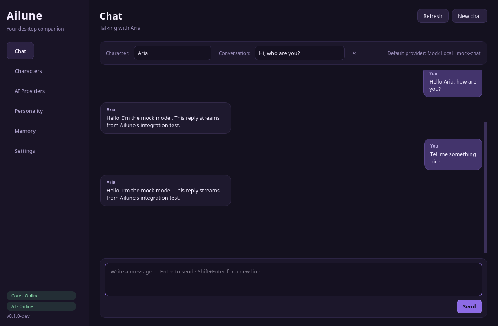
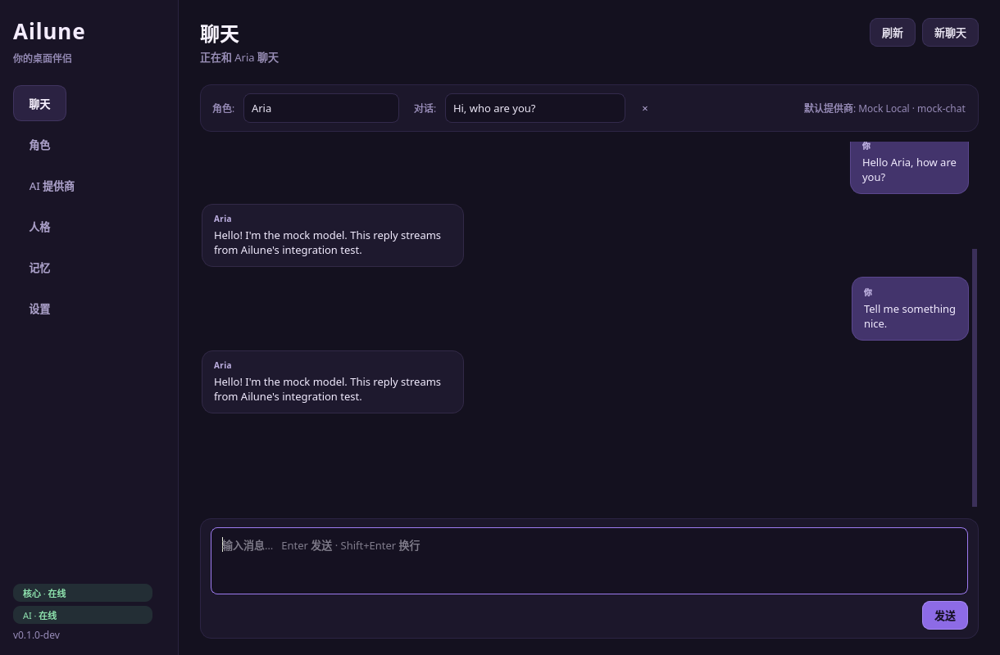

# Ailune

**English** | [简体中文](README_CN.md)

A customizable AI desktop companion for Linux — bring your own Live2D character,
personality and language model.

> **Status: early prototype (0.1.0-dev).** The desktop window, local services,
> model import/validation, provider layer, chat UI and EN/ZH interface are
> working on Arch Linux + Niri + Wayland. The included character renderer is a
> hand-drawn Canvas2D placeholder; the Live2D Cubism runtime is intentionally not
> bundled and is the next major milestone.
>
> Pointer drag and click-through are implemented through a clipped GDK input
> region and the layer surface was verified live. The validation sandbox had no
> pointer injection device, so a manual mouse pass is still recommended; see
> [docs/NIRI.md](docs/NIRI.md).


## What works today

- **Desktop pet on Wayland layer shell** — transparent, borderless, full-output
  overlay above tiled windows; survives workspace switches; per-output layer
  surface; clipped input region for click-through; drag and right-click menu.
- **Live2D model library** — import `.model3.json` folders, recursively discover
  entries, validate every referenced `moc3`, texture, physics, pose, motion,
  expression and sound, reject path traversal, preview a texture, copy only the
  referenced files into the Ailune library.
- **AI provider layer** — OpenAI-compatible APIs (OpenAI, DeepSeek, Zhipu,
  DashScope, Moonshot, LM Studio, custom), native Ollama, streaming, cancellation,
  connection tests, per-provider model/temperature/token/timeout/extra parameters.
- **Chat** — streaming replies, Markdown bubbles, persisted conversations,
  per-character history, pet speech-bubble forwarding and expression reactions.
- **Personalities and memory** — editable system prompts, character binding,
  independent conversations, manual memory notes injected into the prompt.
- **Bilingual UI** — English and 简体中文, switchable live; default English;
  JSON catalogs with a parity test.
- **Local-first architecture** — Go core and Python AI service bind loopback only,
  share a 0600 token, and persist under XDG directories. API keys are write-only
  from the UI's perspective.

## What is not implemented yet

- Real Live2D Cubism rendering. The SDK has separate licensing; the renderer
  exposes a documented adapter point (`renderer/src/live2d/adapter.js`) and falls
  back to the placeholder. Model validation and storage are complete.
- ASR, TTS and lip sync (bridge methods `setSpeaking` / `setMouth` are ready).
- Automatic long-term memory extraction, embeddings and memory search.
- Phoneme-level lip sync, plugin system, proactive conversation, computer control.
- A production package. The current setup is a development checkout.

See [docs/DECISIONS.md](docs/DECISIONS.md) for the architectural choices and
[docs/NIRI.md](docs/NIRI.md) for the window validation record.

## Screenshots

| Chat | 中文界面 |
| --- | --- |
|  |  |

## Architecture

```text
                    Niri / Wayland
                          │
      ┌───────────────────┼───────────────────┐
      ▼                   ▼                   ▼
┌─────────────┐    ┌─────────────┐    ┌─────────────┐
│  Go core    │    │  PyQt6 UI   │    │  Pet shell  │
│  :8766      │◄──►│  settings   │    │ GTK4 layer  │
│  state/SSE  │    │  chat       │    │ + WebKitGTK │
└──────┬──────┘    └──────┬──────┘    └──────┬──────┘
       │ HTTP+SSE         │ HTTP+SSE         │ WebGL/Canvas
       ▼                  ▼                  ▼
┌─────────────────────────────────────────────────────┐
│         Python AI service (FastAPI, :8765)          │
│  providers · secrets · SQLite · chat · personalities│
│                    · memory                         │
└─────────────────────────────────────────────────────┘
```

- **Go core** owns lifecycle, state, the authenticated control API, SSE events,
  process supervision, Niri diagnostics and spawning the UI/pet.
- **Python AI service** owns provider adapters, API keys, SQLite (characters,
  providers, conversations, messages, memories, personalities), and streaming chat.
- **PyQt6 UI** is the settings/chat interface. It talks to both HTTP services.
- **Pet shell** is a Python GTK4 layer-shell process hosting a WebKitGTK page from
  a loopback renderer server. The page draws the character and communicates with
  GTK through a small script-message bridge.

More detail: [docs/ARCHITECTURE.md](docs/ARCHITECTURE.md).

## Requirements

Target: **Arch Linux + Niri + Wayland** (other Wayland compositors may work; the
layer-shell/input-region path is tested on Niri 26.04).

System packages:

```bash
sudo pacman -S go uv curl gtk4 gtk4-layer-shell webkitgtk-6.0 python-gobject \
               qt6-base qt6-wayland
```

Python packages (installed into `.venv` by the setup script): `PyQt6`, `httpx`,
`fastapi`, `uvicorn`, `pytest`.

> PyQt6 wheels are used from PyPI. The system `python-gobject`, GTK4,
> gtk4-layer-shell and WebKitGTK are required for the pet; that is why the venv is
> created with `--system-site-packages`.

## Quick start

```bash
git clone <your-repo> Ailune
cd Ailune
./scripts/setup.sh
make doctor
make run
```

`make run` builds the Go binary, starts the core + AI service + pet shell, then
opens the PyQt6 window. The development launcher keeps state in `.local/` so it
does not affect your normal Ailune configuration.

To stop everything, close the UI window or press Ctrl+C in the terminal.

Useful commands:

```bash
make run                    # core + AI service + pet + UI
./scripts/dev.sh --no-ui    # headless core + services
make core                   # core only
make ui             # UI only (expects a running core)
make pet            # pet only (expects a running core)
make service        # AI service only
make doctor         # dependency/session diagnostics
make test           # Go + Python tests
```

Production-style paths (no dev isolation):

```bash
./build/ailune run       # uses $XDG_CONFIG_HOME/ailune, $XDG_DATA_HOME/ailune
./build/ailune ui        # from another terminal, or use the pet menu → Settings
```

The first run creates `api-token` (0600) and `config.json` under the configuration
directory. Both services bind `127.0.0.1` only and require the token for all
sensitive endpoints.

## Using Ailune

1. **Import a character** — open *Characters → Import model…*, choose a folder
   containing `*.model3.json`, review the validation report, optionally copy only
   referenced files into the library, bind a personality and choose a reply
   language.
2. **Configure a model provider** — open *AI Providers → Add provider*. Choose a
   preset or a custom OpenAI-compatible endpoint, fill in the base URL, model and
   key, then **Test connection**.
3. **Activate** — in *Characters*, click **Show on desktop**.
4. **Chat** — send a message in *Chat*. The reply streams into the UI and the pet
   shows a short speech bubble.
5. **Right-click the pet** for Chat / Settings / Hide / Reload / Quit.

The AI reply language is separate from the interface language: each character
can follow the user's language, always reply in English, or always reply in
Simplified Chinese.

## Repository layout

```text
Ailune/
├── cmd/ailune/                 Go entry point and CLI
├── internal/                   Go core (config, state, API, events, niri, supervisor)
├── python/
│   ├── pyproject.toml
│   ├── ailune/
│   │   ├── ai/                 provider interfaces and adapters
│   │   ├── service/            FastAPI service, SQLite, secrets, chat engine
│   │   ├── ui/                 PyQt6 pages, i18n catalogs, styles
│   │   ├── pet/                GTK4 layer-shell shell, core client, local server
│   │   ├── models/             model3.json validation and library copy
│   │   └── common/             XDG paths, token and URL helpers
│   └── tests/                  pytest suite
├── renderer/                   HTML/ES-module renderer + Live2D adapter point
├── docs/                       architecture, protocol, Niri validation, decisions
├── scripts/                    setup.sh, dev.sh
├── assets/ models/ configs/    placeholders and defaults
├── WORKLOG.md                  implementation record
└── LESSONS.md                  engineering lessons from this milestone
```

This layout is documented in the work log because the project was created in this
milestone.

## Design highlights

- **Layer shell, not a floating XDG toplevel.** Niri (like most Wayland compositors)
  does not let clients set top-level positions. A full-output layer surface with a
  clipped input region gives a stable pet that appears above tiled windows across
  workspaces. The surface never moves; the character moves inside it, so dragging
  does not fight the compositor.
- **WebKitGTK for the renderer.** PyQt6 cannot host a Qt layer surface; GTK4 +
  gtk4-layer-shell is the reliable path on Niri. The same WebGL page can later host
  the Cubism SDK.
- **Provider adapters, not a vendor SDK.** Streaming, cancellation, timeouts and
  redirects are explicit, and API keys cannot leak through library logs.
- **i18n from day one.** English is the default and every UI string goes through
  one catalog; a test checks key parity between English and Simplified Chinese.
- **No bundled SDKs or models.** Live2D Cubism and third-party character assets
  have their own licenses.

## Development

```bash
make test
cd python && ../.venv/bin/python -m pytest -q
GOCACHE="$PWD/.cache/go-build" go test ./...
```

The current API contracts are in [docs/PROTOCOL.md](docs/PROTOCOL.md). The
development record is in [WORKLOG.md](WORKLOG.md), and the lessons gathered during
the first vertical slice are in [LESSONS.md](LESSONS.md).

Environment overrides useful for development:

| Variable | Purpose |
| --- | --- |
| `AILUNE_ROOT` | checkout root |
| `AILUNE_CONFIG_DIR`, `AILUNE_DATA_DIR`, `AILUNE_RUNTIME_DIR`, `AILUNE_CACHE_DIR` | isolated paths |
| `AILUNE_CONFIG_FILE` | explicit config file |
| `AILUNE_TOKEN` | shared local API token |
| `AILUNE_CORE_URL`, `AILUNE_AI_URL` | service URLs for the UI/pet |
| `AILUNE_AI_LISTEN` | AI service listen address |
| `AILUNE_SECRET_BACKEND` | `file` (default) or `secret-service` |
| `AILUNE_DEBUG=1` | verbose pet/renderer diagnostics |

## Security and privacy

- Both HTTP services bind loopback only and require a random 32-byte token stored
  with mode `0600`.
- Provider keys are never returned by the API. The default store is a `0600`
  JSON file; `AILUNE_SECRET_BACKEND=secret-service` stores them in the desktop
  keyring via `secret-tool`.
- The renderer is served from a random loopback port and only exposes the active
  model directory. Remote content is disallowed by CSP.
- Chats and characters stay in local SQLite. Cloud providers of course receive
  the messages you send them.

See [docs/SECURITY.md](docs/SECURITY.md).

## Licensing

Application code is licensed under GPL-3.0-or-later (matching the PyQt6 licensing
path used here); the full text is in [LICENSE](LICENSE). This is a development prototype; confirm PyQt6, Live2D Cubism SDK,
Qt/WebKit and any third-party model licenses before distributing binaries or model
assets. No Live2D model or SDK is included in this repository.

## Documentation

- [Architecture](docs/ARCHITECTURE.md)
- [HTTP/SSE protocol](docs/PROTOCOL.md)
- [Niri / Wayland validation](docs/NIRI.md)
- [Decision records](docs/DECISIONS.md)
- [Security notes](docs/SECURITY.md)
- [Work log](WORKLOG.md)
- [Lessons](LESSONS.md)
