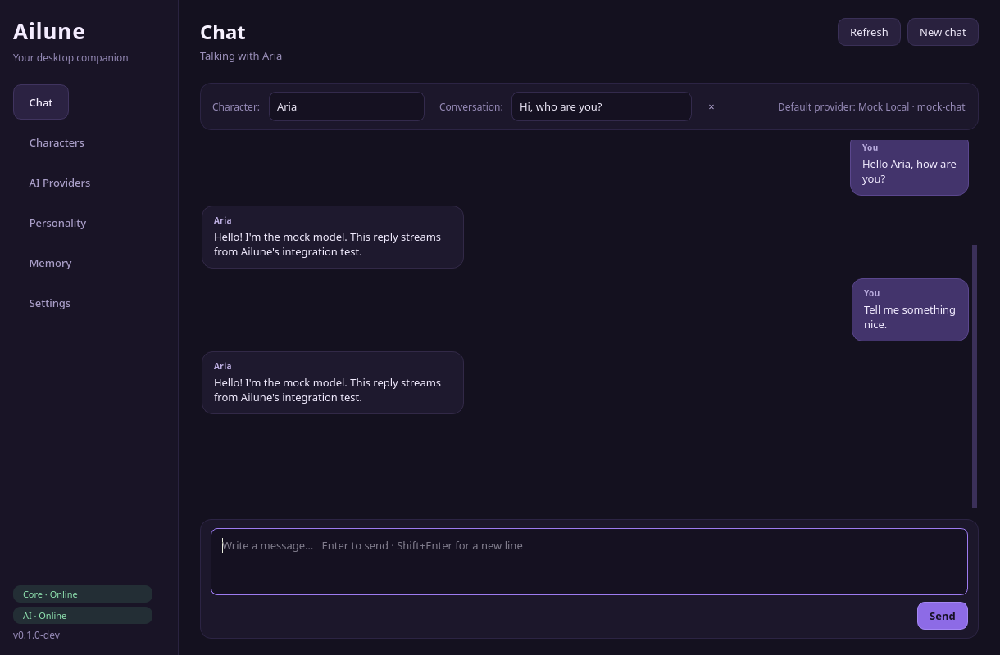
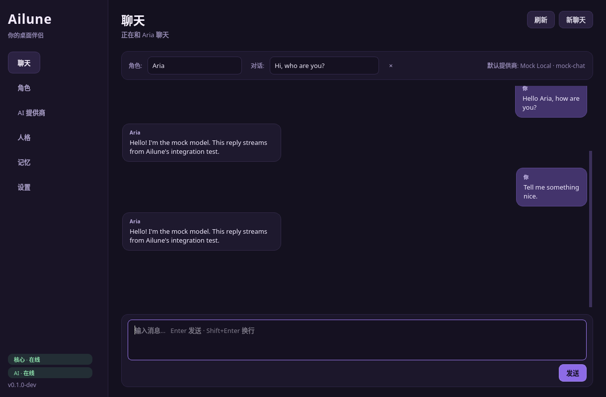

# Ailune

面向 Linux 的可定制 AI 桌面伴侣 —— 使用你自己的 Live2D 角色、人格和语言模型。

[English](README.md) | **简体中文**

> **状态：早期原型（0.1.0-dev）。** 桌面窗口、本地服务、模型导入/校验、
> AI 提供商适配层、聊天界面和中英文界面已经可以在 Arch Linux + Niri + Wayland
> 上运行。当前内置的角色渲染器是一个手绘 Canvas2D 占位角色；Live2D Cubism
> 运行时没有随仓库分发，是下一个主要里程碑。
>
> 拖拽和鼠标穿透通过裁剪后的 GDK 输入区域实现，覆盖层也已在实际会话中验证。
> 但验证环境没有指针注入设备，仍建议用真实鼠标手动检查这些交互；详见
> [docs/NIRI.md](docs/NIRI.md)。


## 目前可用

- **基于 Wayland layer shell 的桌宠** —— 透明、无边框、覆盖整个输出，位于平铺
  窗口之上；切换工作区后仍然显示；按输出创建 layer surface；通过裁剪输入区域
  支持鼠标穿透；支持拖拽和右键菜单。
- **Live2D 模型库** —— 导入包含 `.model3.json` 的文件夹，递归查找入口文件，
  校验所有引用的 `moc3`、贴图、物理、Pose、动作、表情和声音，拒绝路径穿越，
  显示贴图预览，并支持只把被引用的文件复制到 Ailune 模型库。
- **AI 提供商适配层** —— 支持 OpenAI 兼容接口（OpenAI、DeepSeek、智谱、
  通义千问、Moonshot、LM Studio、自定义接口）和原生 Ollama；支持流式输出、
  取消、连接测试，以及每个提供商独立的模型、温度、Token 上限、超时和额外参数。
- **聊天** —— 流式回复、Markdown 气泡、会话持久化、按角色隔离的聊天记录、
  桌宠语音气泡转发和表情联动。
- **人格与记忆** —— 可编辑系统提示词、角色人格绑定、独立会话，以及会注入
  提示词的手动记忆笔记。
- **双语界面** —— English 与简体中文，运行时即时切换，默认 English；
  使用 JSON 翻译目录，并有一致性测试。
- **本地优先架构** —— Go 核心和 Python AI 服务只监听 loopback，共享权限
  `0600` 的本地令牌，数据保存在 XDG 目录中。API Key 从 UI 视角只能写入，
  不会再次显示。

## 尚未实现

- 真正的 Live2D Cubism 渲染。SDK 有独立的授权条款；渲染器已经提供文档化的
  适配点（`renderer/src/live2d/adapter.js`），找不到适配器时会回退到占位角色。
  模型的校验和存储已经完成。
- ASR、TTS 和口型同步（桥接方法 `setSpeaking` / `setMouth` 已经预留）。
- 自动长期记忆提取、向量检索和记忆搜索。
- 音素级口型同步、插件系统、主动聊天和电脑控制。
- 生产级安装包；当前仍是开发用源码检出。

架构选择见 [docs/DECISIONS.md](docs/DECISIONS.md)，窗口验证记录见
[docs/NIRI.md](docs/NIRI.md)。

## 截图

| 聊天 | 中文界面 |
| --- | --- |
|  |  |

> 截图中的 `Mock Local` 是本地测试提供商。

## 架构

```text
                    Niri / Wayland
                          │
      ┌───────────────────┼───────────────────┐
      ▼                   ▼                   ▼
┌─────────────┐    ┌─────────────┐    ┌─────────────┐
│  Go 核心    │    │  PyQt6 UI   │    │  桌宠 Shell │
│  :8766      │◄──►│  设置/聊天  │    │ GTK4 Layer  │
│  状态/SSE   │    │             │    │ + WebKitGTK │
└──────┬──────┘    └──────┬──────┘    └──────┬──────┘
       │ HTTP+SSE         │ HTTP+SSE         │ WebGL/Canvas
       ▼                  ▼                  ▼
┌─────────────────────────────────────────────────────┐
│      Python AI 服务（FastAPI，:8765）               │
│ 提供商 · 密钥 · SQLite · 聊天 · 人格 · 记忆          │
└─────────────────────────────────────────────────────┘
```

- **Go 核心**负责生命周期、状态、带认证的控制 API、SSE 事件、进程监督、
  Niri 诊断，以及启动 UI 和桌宠。
- **Python AI 服务**负责提供商适配器、API Key、SQLite（角色、提供商、会话、
  消息、记忆、人格）和流式聊天。
- **PyQt6 UI** 是设置和聊天界面，同时访问两个 HTTP 服务。
- **桌宠 Shell** 是一个 Python GTK4 layer-shell 进程，从 loopback 渲染服务器
  加载 WebKitGTK 页面。页面负责绘制角色，并通过轻量的脚本消息桥与 GTK 通信。

详细说明：[docs/ARCHITECTURE.md](docs/ARCHITECTURE.md)。

## 环境要求

目标环境：**Arch Linux + Niri + Wayland**（其他 Wayland 合成器可能也能运行；
layer-shell 和输入区域方案在 Niri 26.04 上验证过）。

系统软件包：

```bash
sudo pacman -S go uv curl gtk4 gtk4-layer-shell webkitgtk-6.0 python-gobject \
               qt6-base qt6-wayland
```

Python 依赖（由安装脚本装入 `.venv`）：`PyQt6`、`httpx`、`fastapi`、
`uvicorn`、`pytest`。

> PyQt6 使用 PyPI 上的 wheel。桌宠需要系统的 `python-gobject`、GTK4、
> gtk4-layer-shell 和 WebKitGTK，因此虚拟环境使用
> `--system-site-packages` 创建。

## 快速开始

```bash
git clone <your-repo> Ailune
cd Ailune
./scripts/setup.sh
make doctor
make run
```

`make run` 会构建 Go 二进制，启动核心、AI 服务和桌宠 Shell，然后打开 PyQt6
窗口。开发启动器把状态保存在 `.local/`，不会影响你日常使用的 Ailune 配置。

停止方式：关闭 UI 窗口，或在终端按 Ctrl+C。

常用命令：

```bash
make run                    # 核心 + AI 服务 + 桌宠 + UI
./scripts/dev.sh --no-ui    # 无界面启动核心和服务
make core                   # 仅核心
make ui                     # 仅 UI（需要已运行的核心）
make pet                    # 仅桌宠（需要已运行的核心）
make service                # 仅 AI 服务
make doctor                 # 依赖和会话诊断
make test                   # Go + Python 测试
```

使用正式 XDG 路径（不带开发隔离）：

```bash
./build/ailune run       # 使用 $XDG_CONFIG_HOME/ailune、$XDG_DATA_HOME/ailune
./build/ailune ui        # 在另一个终端运行，或使用桌宠菜单 → 设置
```

首次运行会在配置目录创建 `api-token`（权限 0600）和 `config.json`。两个服务
都只监听 `127.0.0.1`，所有敏感接口都需要该令牌。

## 使用 Ailune

1. **导入角色** —— 打开 *角色 → 导入模型…*，选择包含 `*.model3.json` 的
   文件夹，查看校验报告，可以选择只把被引用的文件复制到模型库，然后绑定人格
   并选择回复语言。
2. **配置模型提供商** —— 打开 *AI 提供商 → 添加提供商*。选择预设或自定义
   OpenAI 兼容接口，填写 Base URL、模型和密钥，然后点击 **测试连接**。
3. **激活角色** —— 在 *角色* 页面点击 **显示在桌面**。
4. **聊天** —— 在 *聊天* 页面发送消息。回复会流式显示在 UI 中，桌宠同时显示
   一条简短的气泡。
5. **右键桌宠** —— 可以打开聊天、设置、隐藏、重新加载或退出。

AI 回复语言与界面语言相互独立：每个角色可以跟随用户语言，始终用英语回复，
或始终用简体中文回复。

## 仓库结构

```text
Ailune/
├── cmd/ailune/                 Go 入口和 CLI
├── internal/                   Go 核心（配置、状态、API、事件、Niri、进程监督）
├── python/
│   ├── pyproject.toml
│   ├── ailune/
│   │   ├── ai/                 提供商接口和适配器
│   │   ├── service/            FastAPI 服务、SQLite、密钥、聊天引擎
│   │   ├── ui/                 PyQt6 页面、翻译目录、样式
│   │   ├── pet/                GTK4 layer-shell、核心客户端、本地服务器
│   │   ├── models/             model3.json 校验和模型库复制
│   │   └── common/             XDG 路径、令牌和 URL 辅助模块
│   └── tests/                  pytest 测试
├── renderer/                   HTML/ES Module 渲染器和 Live2D 接入点
├── docs/                       架构、协议、Niri 验证、决策和安全说明
├── scripts/                    setup.sh、dev.sh
├── assets/ models/ configs/    占位资源和默认配置
├── WORKLOG.md                  实现记录
└── LESSONS.md                  本阶段的工程教训
```

本次里程碑创建了上述目录，详细变更记录在工作日志中。

## 设计要点

- **使用 layer shell，而不是浮动 XDG 顶层窗口。** Niri（以及大多数 Wayland
  合成器）不允许客户端设置顶层窗口位置。覆盖整个输出的 layer surface 配合
  裁剪输入区域，可以得到一个稳定、位于平铺窗口之上、跨工作区显示的桌宠。
  surface 本身不移动，角色在 surface 内部移动，因此拖拽不会和合成器互相打架。
- **使用 WebKitGTK 承载渲染器。** PyQt6 无法承载 Qt layer surface；在 Niri 上
  GTK4 + gtk4-layer-shell 是可靠路径。同一个 WebGL 页面后续可以承载 Cubism SDK。
- **使用提供商适配器，而不是厂商 SDK。** 流式输出、取消、超时和重定向都由
  项目显式控制，API Key 不会通过第三方 SDK 日志泄漏。
- **从第一天支持国际化。** 默认英语，所有界面文本走统一翻译目录；测试会检查
  英文和简体中文的 key 是否一致。
- **不捆绑 SDK 和模型。** Live2D Cubism 与第三方角色素材都有各自授权。

## 开发

```bash
make test
cd python && ../.venv/bin/python -m pytest -q
GOCACHE="$PWD/.cache/go-build" go test ./...
```

当前 API 约定见 [docs/PROTOCOL.md](docs/PROTOCOL.md)。开发记录见
[WORKLOG.md](WORKLOG.md)，第一阶段总结的工程教训见 [LESSONS.md](LESSONS.md)。

开发用环境变量：

| 变量 | 用途 |
| --- | --- |
| `AILUNE_ROOT` | 源码检出根目录 |
| `AILUNE_CONFIG_DIR`、`AILUNE_DATA_DIR`、`AILUNE_RUNTIME_DIR`、`AILUNE_CACHE_DIR` | 隔离目录 |
| `AILUNE_CONFIG_FILE` | 指定配置文件 |
| `AILUNE_TOKEN` | 共享的本地 API 令牌 |
| `AILUNE_CORE_URL`、`AILUNE_AI_URL` | UI/桌宠使用的服务地址 |
| `AILUNE_AI_LISTEN` | AI 服务监听地址 |
| `AILUNE_SECRET_BACKEND` | `file`（默认）或 `secret-service` |
| `AILUNE_DEBUG=1` | 桌宠/渲染器详细诊断日志 |

## 安全与隐私

- 两个 HTTP 服务只监听 loopback，并要求随机的 32 字节令牌；令牌文件权限为
  `0600`。
- 提供商密钥不会通过 API 返回。默认存储在权限 `0600` 的 JSON 文件中；
  设置 `AILUNE_SECRET_BACKEND=secret-service` 后，会通过 `secret-tool`
  存入桌面密钥环。
- 渲染器从随机 loopback 端口提供，只暴露当前模型目录；CSP 禁止远程内容。
- 聊天和角色数据保存在本地 SQLite。使用云端提供商时，你发送的消息当然会
  发送给该提供商。

详见 [docs/SECURITY.md](docs/SECURITY.md)。

## 许可证

应用代码采用 GPL-3.0-or-later（与该项目使用的 PyQt6 授权路径一致）；完整文本见
[LICENSE](LICENSE)。当前仍是开发原型；在分发二进制或模型素材前，请确认 PyQt6、
Live2D Cubism SDK、Qt/WebKit 及第三方模型的授权。仓库不包含任何 Live2D 模型或
SDK。

## 文档

- [架构](docs/ARCHITECTURE.md)
- [HTTP/SSE 协议](docs/PROTOCOL.md)
- [Niri / Wayland 验证](docs/NIRI.md)
- [架构决策记录](docs/DECISIONS.md)
- [安全说明](docs/SECURITY.md)
- [工作日志](WORKLOG.md)
- [工程教训](LESSONS.md)

> 说明：详细设计文档目前以英文维护，本文件是 README 的简体中文版本。
