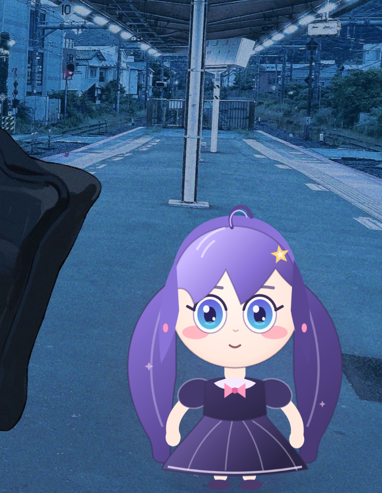

# Niri / Wayland validation

This document records the window experiments that shaped the pet architecture.
The target session was a live Arch Linux installation:

| Component | Version / value |
| --- | --- |
| Compositor | Niri 26.04 (`8ed0da4`) |
| Session | Wayland (`wayland-1`, `XDG_SESSION_TYPE=wayland`) |
| Output | eDP-1, 2560×1600@180, logical scale 1.5, 1706×1066 logical |
| GTK | 4.24.1 |
| gtk4-layer-shell | 1.3.0 |
| WebKitGTK | 2.54.2 |
| PyQt6 | 6.12.0 |
| Go | 1.27.3 |

The test agent ran inside a restricted sandbox without `/dev/dri` or `/dev/uinput`.
That is relevant to the GPU and input-injection notes below.

## What was verified

### 1. Layer-shell surface

A GTK4 application window initialized with `Gtk4LayerShell` appeared in
`niri msg layers` as:

```json
{"namespace":"ailune-pet","output":"eDP-1","layer":"Overlay","keyboard_interactivity":"None"}
```

The surface was anchored to all four edges, with zero margins and exclusive zone.
It is an overlay above tiled windows and other top layers created later.

**Result: works.**

### 2. Transparency

Transparency requires all of:

1. GTK CSS: `window, window.background, .background { background-color: transparent; }`
2. WebKit: `WebView.set_background_color(Gdk.RGBA(0,0,0,0))`
3. HTML/CSS: `html, body { background: transparent; }`

With all three, a full-output WebKit page composites correctly and the wallpaper
and windows remain visible. A screenshot pixel comparison against a hidden-pet
screenshot showed identical desktop pixels outside the character.

**Result: works with software rendering; the same path is used with hardware WebGL.**

### 3. Web renderer inside the layer surface

WebKitGTK loaded the renderer from a loopback HTTP server and drew a Canvas2D
character with animations, a speech bubble, and a DOM context menu. WebKit's
WebGL context is available in the code and is used by the Live2D adapter point,
but this sandbox has no GPU device, so WebGL *content* could not be validated here.
Canvas2D rendering works with `WEBKIT_DISABLE_COMPOSITING_MODE=1` and
`LIBGL_ALWAYS_SOFTWARE=1`.

**Result: WebKit host works; GPU/WebGL verification remains a target-machine step.**

### 4. Positioning and workspace behaviour

The surface covers the selected output and stays in place when the character moves
inside it. It is a layer surface, not a toplevel, so it is not tiled, does not need
`open-floating` window rules, and does not consume a workspace column.

The pet was still visible after switching from workspace 3 to workspace 5 and
back. This is the intended behaviour of a layer overlay on that output.

**Result: works (observed with screenshots).**

### 5. Dynamic character position (design)

Niri (and Wayland generally) does not allow an XDG toplevel to set its own global
position. Niri 26.04 does offer `move-floating-window` for floating toplevels, but
that only works for XDG windows and brings compositor-specific rules into the
design.

Instead, the surface is fixed and the character is a DOM/canvas element inside it.
The pet reports only the character box as the input region. Dragging changes the
canvas position and reports it to the Python shell, which persists it. This avoids
the classic layer-shell drag feedback loop entirely.

**Result: implemented; pointer-level manual testing still recommended (no
`/dev/uinput` in the validation sandbox).**

### 6. Input region / click-through

`Gdk.Surface.set_input_region(cairo.Region)` is available in GTK4. The pet sets it
to the character rectangle plus the open menu rectangle. An empty region is used
when click-through is enabled or the pet is hidden. This is the mechanism that
keeps the transparent full-output surface from eating desktop clicks.

The GDK call succeeds in the live session and is exercised on every layout/menu
change. Actual click-through could not be injected in the sandbox because
`/dev/uinput` is absent; it should be verified manually on the target machine:

1. Click the wallpaper outside the character and confirm the window underneath gets
   the click.
2. Enable *Click-through* in Settings; confirm the character ignores clicks.
3. Disable it from the settings UI, then click and drag the character.

**Result: implemented, call verified, end-to-end pointer test pending.**

### 7. LD_PRELOAD requirement

PyGObject loads `libwayland-client` before `libgtk4-layer-shell`, causing:

```text
Failed to initialize layer surface, GTK4 Layer Shell may have been linked after libwayland.
```

`python -m ailune.pet` detects the library and re-executes itself with
`LD_PRELOAD=/usr/lib/libgtk4-layer-shell.so`. The surface then initializes. This is
handled automatically; no user action is needed.

**Result: works.**

## What Niri configuration is needed?

**None for the pet.** No window rule or layer rule is required. The pet sets its
namespace to `ailune-pet`. An optional cosmetic rule can remove the layer shadow
or adjust opacity, but Ailune never edits the user's Niri config:

```kdl
// Optional, not required.
layer-rule {
    match namespace="^ailune-pet$"
    shadow { off; }
}
```

Niri 26.04 supports layer rules with `opacity`, `shadow`, `geometry-corner-radius`
and background effects, but no input-region or arbitrary-position directive. The
input region is therefore handled by GDK/Wayland directly.

## Known limitations

- **Full-output surface.** The overlay covers the output. It is transparent and
  input-clipped, but the compositor still composites a full-size buffer. On high
  refresh-rate 4K displays this can cost more than a tightly sized surface. Reducing
  the renderer's internal resolution or moving to a smaller surface with an input
  anchor protocol is future work.
- **Single output at a time.** The state carries an `output` connector; the pet
  chooses the matching GdkMonitor. There is no UI yet for moving the pet between
  monitors at runtime.
- **Workspace mapping.** The pet is per-output, not per-workspace. That is usually
  desired for a desktop companion, but it means it appears on all workspaces of that
  output.
- **Input region is rectangular.** Transparent padding inside the character box
  still receives clicks. The box is kept tight around the body.
- **GPU / WebGL.** Validate on the target machine with a real DRI device. Niri
  screenshots and WebKit need a working EGL/GL stack for Live2D.
- **Pointer tests.** The sandbox had no `/dev/uinput`; use a real mouse for drag,
  menu and click-through checks.

## Reproduction commands

```bash
# Core API state (token required)
curl -H "Authorization: Bearer $(cat .local/config/api-token)" \
     http://127.0.0.1:8766/api/v1/state

# List the pet's layer surface
niri msg --json layers | grep ailune-pet

# Take a screenshot (uses niri's configured screenshot path)
niri msg action screenshot-screen

# Pet diagnostics
AILUNE_DEBUG=1 ./build/ailune pet
```

## Evidence

The clean pet screenshot in this repository was captured on workspace 5 with the
image viewer and file manager on other workspaces:


